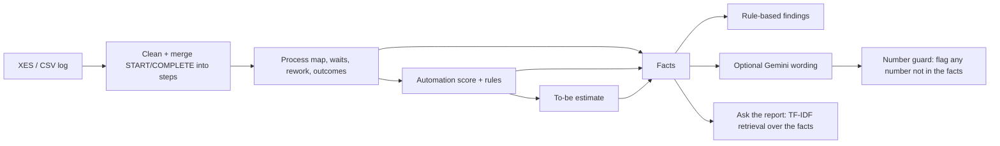

# 🧶 UnJam: loan process bottleneck and automation finder

**UnJam untangles a bank loan process.** Give it a real event log (who did which step, when) and it shows where
applications wait, which steps are repeated, how cases end, and which steps are routine enough for rule-based
automation. It then estimates the benefit of the top improvements and drafts the findings and the functional
requirements. **No model is trained.** This is business process analysis with a small, controlled AI layer.

Built on the **BPI Challenge 2012** loan application log (real, anonymised, about 13,000 applications).
This is a *proxy process* from a Dutch financial institution, not a Bangladeshi bank.

## What you get

| Question | Where in the app |
|---|---|
| What does the process really look like? | **As-is map** (colour = waiting time, width = volume), Mermaid export |
| Where is time lost? | **Bottlenecks**: median, 90th percentile and total wait; slowest 10% of cases vs the rest |
| What is repeated, and what does it cost? | **Rework**: repeated steps, hours spent, A→A and A→B→A loops |
| How do applications end? | **Outcomes**: approved / declined / cancelled and where cases get stuck |
| What can be automated? | **Automation**: score = volume × repetition × waiting time + rules and a written reason per step |
| What would it save? | **To-be**: pick changes, see median and p90 case duration before/after, with the assumption shown |
| Can I trust it? | **Checks**: the numbers reconcile; two different metrics agree |
| What do I tell my manager? | **Report & Ask**: findings, recommendations, FSD draft; ask questions answered only from the results |

## Quick start

**Windows:** double-click `run_windows.bat` (creates a virtual environment, installs, starts the app).

**Manual (any OS, Python 3.10+):**

```bash
python -m venv .venv
.venv\Scripts\activate          # macOS/Linux: source .venv/bin/activate
pip install -r requirements.txt
python check_setup.py
python -m streamlit run app.py
```

### Add the real data

1. Open the dataset page: https://data.4tu.nl/articles/dataset/BPI_Challenge_2012/12689204/1 and read the licence.
2. Download `BPI_Challenge_2012.xes.gz` (3.3 MB). Do not unzip it.
3. Save it as `data/real/BPI_Challenge_2012.xes.gz`, reload the app and pick it in the sidebar.

Without a file the app shows a start guide. It never analyses made-up data. Your own logs work too
(`.xes`, `.xes.gz`, `.csv`, `.zip` with a case id, an activity and a timestamp).

### Run without the browser (results for your documents)

```bash
python export_report.py
```

This writes `outputs/` (report, facts, CSV tables, Mermaid diagrams) and generates `docs/RESULTS.md` and
`docs/PROCESS_MAPS.md` with the real numbers and the discovered as-is / to-be maps.

### Optional: AI wording with Gemini

Copy `.env.example` to `.env`, paste a `GEMINI_API_KEY`, then switch on *Use Gemini to explain the facts* in the sidebar
(or run `python export_report.py --llm`). Without a key everything works; the text is then written by rules.
Only the aggregated facts are sent, never raw events.

## How it works



Rules in one place (full detail in [`docs/FSD.md`](docs/FSD.md)):

- **Wait** of a step = gap between the end of the latest earlier work in the case and the start of the step (never negative).
- **Automation candidate** = busy (share of cases) **and** slow (median wait) **and** predictable (p90 / median wait), and not a decision step. All three thresholds are adjustable.
- **To-be estimate** = automated steps wait X% less (default 50%) and repeated runs are removed. It is an assumption, not a measured result.

## Documents (business analysis pack)

| Document | Purpose |
|---|---|
| [`docs/PROJECT_SPEC.md`](docs/PROJECT_SPEC.md) | One-page brief of the whole project |
| [`docs/BRD.md`](docs/BRD.md) | Business requirements, stakeholders, rules, risks |
| [`docs/FSD.md`](docs/FSD.md) | Functional requirements FR-01 to FR-21, formulas, data definitions |
| [`docs/USE_CASES.md`](docs/USE_CASES.md) | Five use cases |
| [`docs/PROCESS_FLOWS.md`](docs/PROCESS_FLOWS.md) | Process improvement flow today vs with UnJam |
| [`docs/TEST_CASES.md`](docs/TEST_CASES.md) | 30 test cases and traceability matrix |
| [`docs/AI_LIMITATIONS.md`](docs/AI_LIMITATIONS.md) | Where AI is used, hallucination guard, privacy, fairness |
| [`docs/AI_USAGE_LOG.md`](docs/AI_USAGE_LOG.md) | How AI assistants were used to build this |
| [`docs/STAKEHOLDER_QUESTIONS.md`](docs/STAKEHOLDER_QUESTIONS.md) | Interview guide for loan officer, ops manager, risk |

After you run `python export_report.py`, see also `docs/RESULTS.md` (findings on the real log) and `docs/PROCESS_MAPS.md`.

## Tests

```bash
python -m pytest -q
```

23 automated tests check the maths against numbers worked out by hand on a tiny log (see `tests/helpers.py`),
including the XES parser, waiting-time rule, outcome detection, scoring rules, to-be estimate, the number guard
and the AI fallback.

## Project structure

```
app.py                 Streamlit app
export_report.py       headless analysis and report export
unjam/
  loader.py            XES/CSV reader, cleaning, step instances, waiting times
  analysis.py          step metrics, transitions, variants, rework, slow cases
  decisions.py         outcomes, automation scoring, to-be estimate
  flow.py              process map -> Graphviz DOT and Mermaid
  pipeline.py          one-call analysis and self-checks
  llm.py               Gemini call, number guard, TF-IDF retrieval
  report.py            facts, rule-based and AI findings, report export
  ui.py                look and feel (CSS, page header); change the colour here
.streamlit/config.toml  theme colour
tests/                 pytest suite
docs/                  BRD, FSD, use cases, test cases, AI notes
data/real/             put the real event log here (git-ignored)
```

## Limitations

Proxy data from another country. Waiting time includes nights and weekends. Savings are assumption-based.
Decision steps are recognised by keywords. Only timing and sequence are analysed, no customer attributes.
Every recommendation needs validation by a process owner. Details: [`docs/AI_LIMITATIONS.md`](docs/AI_LIMITATIONS.md).

## Data citation

van Dongen, B.F. (2012). *BPI Challenge 2012*. 4TU.ResearchData. https://doi.org/10.4121/uuid:3926db30-f712-4394-aebc-75976070e91f
(licence: 4TU General Terms of Use). The data file is not included in this repository.
