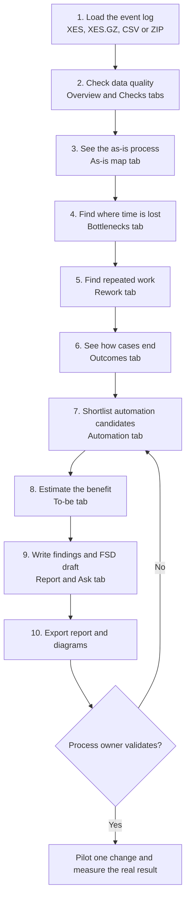
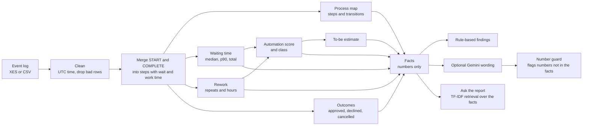
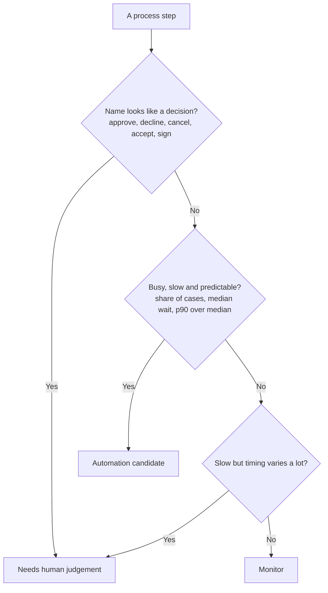

# 🧶 UnJam: Loan Process Bottleneck & Automation Finder


## Business problem

A bank operations manager cannot easily see where loan applications wait, which steps are repeated, and which steps are routine enough to automate. **UnJam turns a real event log into answers, and into documented requirements.**

**My role:** I acted as the business analyst. I turned four business questions into a BRD, a functional specification, use cases, user stories, test cases with traceability, and a working analysis tool.

<!-- Add a screenshot of the As-is map or Bottlenecks tab here, then delete this comment:

-->

## Requirements deliverables

| Document | What it shows |
|---|---|
| [BRD](docs/BRD.md) | Business needs, stakeholders, rules, risks |
| [FSD](docs/FSD.md) | 21 functional requirements (FR-01 to FR-21), formulas, definitions |
| [Use Cases](docs/USE_CASES.md) | Five use cases |
| [User Stories](docs/USER_STORIES.md) | User stories with acceptance criteria |
| [Process Flows](docs/PROCESS_FLOWS.md) | Improvement process today vs with UnJam |
| [Test Cases & Traceability](docs/TEST_CASES.md) | 30 test cases mapped to requirements |
| [Stakeholder Questions](docs/STAKEHOLDER_QUESTIONS.md) | Interview guide for loan officer, ops manager, risk |
| [Project Spec](docs/PROJECT_SPEC.md) | One-page brief of the whole project |

## Key findings (BPI Challenge 2012, about 13,000 applications)

- [FINDING 1: the slowest step and its median / p90 wait]
- [FINDING 2: share of cases with rework and hours spent on repeats]
- [FINDING 3: estimated saving from the to-be scenario, under the stated 50% assumption]

Full results: [docs/RESULTS.md](docs/RESULTS.md) · Process maps: [docs/PROCESS_MAPS.md](docs/PROCESS_MAPS.md)

> **Data note:** BPI Challenge 2012 is a real, anonymised loan / overdraft application log from a Dutch financial institution. It is a **proxy process**, not a Bangladeshi bank. Savings are assumption-based estimates, not measured results.

---

## What UnJam does

**UnJam untangles a bank loan process.** It reads a real event log (which step happened to which loan application, and when) and answers four questions a bank operations manager actually asks:

1. **Where do applications wait?** (bottlenecks)
2. **Which steps are repeated?** (rework)
3. **How do applications end, and where do cancelled ones get stuck?** (outcomes)
4. **Which steps are routine enough for rule-based automation, and what would it save?** (automation + to-be estimate)

No prediction model is trained. All numbers come from plain, testable pandas code. An optional AI layer (Gemini) only *explains* the computed numbers, and a guard flags any number it makes up.

---

## Workflow

### 1. Analyst workflow: from log to recommendation



| Step | Tab | What you do | What you learn |
|---|---|---|---|
| 1 | sidebar | Pick `BPI_Challenge_2012.xes.gz` or upload a file | The log is read and cleaned |
| 2 | Overview, Checks | Read case count, median and 90th percentile duration, self-checks | The numbers can be trusted |
| 3 | As-is map | Look for dark-red boxes and thick arrows | What really happens, and where waiting is longest |
| 4 | Bottlenecks | Rank steps by total, median or 90th percentile wait | The 3 steps that lose the most time |
| 5 | Rework | Read share of cases repeating a step and hours spent on repeats | Which repeats cost the most |
| 6 | Outcomes | Compare approved, declined, cancelled; see the step before a case ends | Where cancelled or unfinished cases stop |
| 7 | Automation | Read the class and reason per step; change thresholds in the sidebar | Which steps are rule-based candidates and which need a human |
| 8 | To-be | Select changes, read median and p90 duration before / after | Estimated benefit under a visible assumption |
| 9 | Report & Ask | Generate findings; ask questions about the results | Plain-language summary and FSD draft |
| 10 | Report & Ask | Download the report, or run `python export_report.py` | Files for your BRD, FSD and README |

### 2. Data workflow: what happens inside



### 3. How a step is classified for automation



The three thresholds of the second question are sliders in the sidebar.

---

## What you get in the app

| Tab | Shows |
|---|---|
| **Overview** | Cases, steps, median and 90th percentile duration, duration histogram, most common paths |
| **As-is map** | Process map. Colour = waiting time, arrow width = volume. Export as Mermaid or Graphviz |
| **Bottlenecks** | Step ranking by total / median / p90 wait, slowest transitions, what the slowest 10% of cases have in common |
| **Rework** | Repeated steps, extra runs, hours spent on repeats, A to A and A to B to A loops |
| **Outcomes** | Approved / declined / cancelled shares, duration per outcome, where cases stop |
| **Automation** | Score (volume x repetition x waiting time), class and written reason per step |
| **To-be** | Ranked improvements, before / after duration, to-be map with highlighted steps |
| **Report & Ask** | Findings, recommendations, FSD draft, question box answered only from the results |
| **Checks** | Reconciliation and consistency checks of the numbers |

## Rules in one place

Full detail in [`docs/FSD.md`](docs/FSD.md).

- **Wait** of a step = gap between the end of the latest earlier work in the case and the start of the step. Never negative.
- **Automation score** = 100 x volume x repetition x waiting time, each scaled from 0 to 1.
- **Automation candidate** = busy and slow and predictable, and not a decision step.
- **To-be estimate** = automated steps wait X% less (default 50%) and repeated runs are removed. It is an assumption, not a measured result.
- **AI text** may only restate computed numbers. Anything else is flagged as unverified.

## Limitations

- Proxy data from another country and bank; process, volumes and regulation differ.
- Waiting time includes nights and weekends (no working-calendar correction).
- Savings are assumption-based estimates; a pilot is needed to measure the real effect.
- Decision steps are recognised by keywords in their names.
- Only timing and sequence are analysed (no loan amounts or customer attributes).
- Every recommendation needs validation by a process owner. Details: [`docs/AI_LIMITATIONS.md`](docs/AI_LIMITATIONS.md).

Other documents: [`docs/AI_LIMITATIONS.md`](docs/AI_LIMITATIONS.md) (where AI is used, hallucination guard, privacy, fairness) · [`docs/AI_USAGE_LOG.md`](docs/AI_USAGE_LOG.md) (how AI assistants were used to build this)

---

## Quick start

**Windows, easiest:** double-click `run_windows.bat`.

**VS Code or any terminal (Python 3.10+):**

```bash
python -m venv .venv
.venv\Scripts\activate            # macOS / Linux: source .venv/bin/activate
pip install -r requirements.txt
python check_setup.py
python -m streamlit run app.py
```

The app opens in the browser at `http://localhost:8501`. Stop it with `Ctrl + C`.

### Add the real data

1. Open https://data.4tu.nl/articles/dataset/BPI_Challenge_2012/12689204/1 and read the licence.
2. Download `BPI_Challenge_2012.xes.gz` (about 3.3 MB). Do not unzip it.
3. Save it as `data/real/BPI_Challenge_2012.xes.gz`, reload the app, pick the file in the sidebar.

Without a file the app shows a start guide and never analyses made-up data. Your own logs also work
(`.xes`, `.xes.gz`, `.csv`, `.zip` with a case id, an activity and a timestamp).

### Get the results as files

```bash
python export_report.py
```

Writes `outputs/` (report, facts, CSV tables, Mermaid diagrams) and generates
`docs/RESULTS.md` (findings on the real log) and `docs/PROCESS_MAPS.md`
(discovered as-is and to-be maps).

### Optional: AI wording with Gemini

Copy `.env.example` to `.env`, add `GEMINI_API_KEY`, then switch on *Use Gemini to explain the facts* in the sidebar
(or run `python export_report.py --llm`). Without a key the text is written by rules. Only aggregated facts are sent,
never raw events.

## Tests

```bash
python -m pytest -q
```

23 automated tests check the maths against numbers worked out by hand on a tiny log (`tests/helpers.py`): XES parser,
waiting-time rule, outcome detection, scoring rules, to-be estimate, number guard and AI fallback. The mini log is only a
test fixture; the app never analyses made-up data.

## Project structure

```
app.py                  Streamlit app
export_report.py        headless analysis and report export
check_setup.py          checks Python, packages and data file
unjam/
  loader.py             XES / CSV reader, cleaning, step instances, waiting times
  analysis.py           step metrics, transitions, paths, rework, slow cases
  decisions.py          outcomes, automation scoring, to-be estimate
  flow.py               process map to Graphviz DOT and Mermaid
  pipeline.py           one-call analysis and self-checks
  llm.py                Gemini call, number guard, TF-IDF retrieval
  report.py             facts, rule-based and AI findings, report export
  ui.py                 look and feel (CSS, page header)
.streamlit/config.toml  theme colour
tests/                  pytest suite
docs/                   BRD, FSD, use cases, test cases, AI notes
data/real/              put the real event log here (git-ignored)
```

## Data citation

van Dongen, B.F. (2012). *BPI Challenge 2012*. 4TU.ResearchData.
https://doi.org/10.4121/uuid:3926db30-f712-4394-aebc-75976070e91f (licence: 4TU General Terms of Use).
The data file is not included in this repository.

## Author

Namira Tasnim · [GitHub](https://github.com/NamTas) · [LinkedIn](https://linkedin.com/in/namtas)
