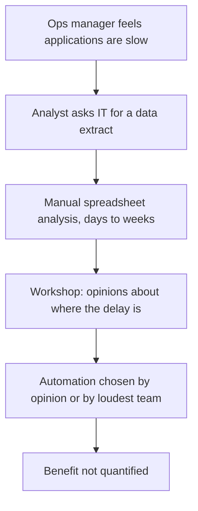
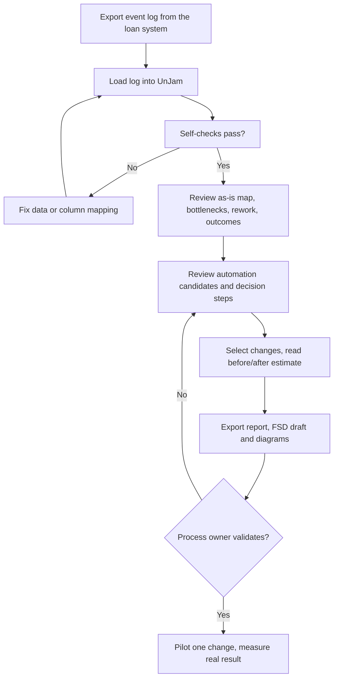

# Process flows

## 1. As-is: how process improvement is done today (assumed, without UnJam)



## 2. To-be: with UnJam



## 3. The discovered process of the loan log (generated, not hand-drawn)

The as-is and to-be maps of the loan process are **generated from the real log**, so they appear only after you run:

```
python export_report.py --log data/real/BPI_Challenge_2012.xes.gz
```

This writes `docs/PROCESS_MAPS.md` (as-is discovered process and to-be with the top automation steps highlighted,
both as Mermaid diagrams that GitHub renders) and `docs/RESULTS.md` (the full findings report).
For a picture file, paste the Mermaid text from `outputs/as_is.mmd` into https://mermaid.live and export PNG or SVG.
