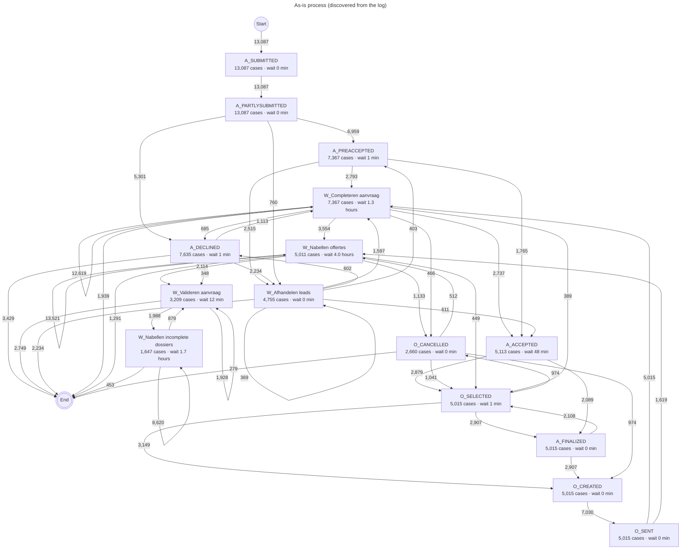

# Discovered process maps

Generated by `python export_report.py` from `BPI_Challenge_2012.xes`. Do not edit by hand; run the command again after changing the data or the settings.

## As-is (discovered from the log)



## To-be (top automation steps highlighted)

```mermaid
---
title: To-be: top automation steps highlighted
---
flowchart TD
  start((Start))
  finish(((End)))
  n0["W_Completeren aanvraag<br/>7,367 cases · wait 1.3 hours"]
  n1["W_Nabellen offertes<br/>5,011 cases · wait 4.0 hours"]
  n2["A_PARTLYSUBMITTED<br/>13,087 cases · wait 0 min"]
  n3["A_SUBMITTED<br/>13,087 cases · wait 0 min"]
  n4["W_Nabellen incomplete dossiers<br/>1,647 cases · wait 1.7 hours"]
  n5["W_Valideren aanvraag<br/>3,209 cases · wait 12 min"]
  n6["A_DECLINED<br/>7,635 cases · wait 1 min"]
  n7["A_PREACCEPTED<br/>7,367 cases · wait 1 min"]
  n8["O_SENT<br/>5,015 cases · wait 0 min"]
  n9["O_SELECTED<br/>5,015 cases · wait 1 min"]
  n10["O_CREATED<br/>5,015 cases · wait 0 min"]
  n11["W_Afhandelen leads<br/>4,755 cases · wait 0 min"]
  n12["A_ACCEPTED<br/>5,113 cases · wait 48 min"]
  n13["A_FINALIZED<br/>5,015 cases · wait 0 min"]
  n14["O_CANCELLED<br/>2,660 cases · wait 0 min"]
  start -->|13,087| n3
  n1 -->|13,521| n1
  n3 -->|13,087| n2
  n0 -->|12,619| n0
  n4 -->|8,620| n4
  n10 -->|7,030| n8
  n2 -->|6,959| n7
  n2 -->|5,301| n6
  n8 -->|5,015| n0
  n0 -->|3,554| n1
  n9 -->|3,149| n10
  n13 -->|2,907| n10
  n9 -->|2,907| n13
  n12 -->|2,879| n9
  n7 -->|2,793| n0
  n0 -->|2,737| n12
  n7 -->|2,515| n11
  n6 -->|2,234| n11
  n1 -->|2,114| n5
  n13 -->|2,108| n9
  n12 -->|2,089| n13
  n5 -->|1,988| n4
  n5 -->|1,928| n5
  n7 -->|1,765| n12
  n8 -->|1,619| n1
  n11 -->|1,597| n0
  n1 -->|1,133| n14
  n6 -->|1,113| n0
  n14 -->|1,041| n9
  n9 -->|974| n14
  n14 -->|974| n10
  n4 -->|879| n5
  n2 -->|760| n11
  n0 -->|685| n6
  n11 -->|611| n12
  n11 -->|602| n6
  n14 -->|512| n1
  n0 -->|466| n14
  n1 -->|449| n9
  n11 -->|403| n7
  n0 -->|389| n9
  n11 -->|369| n11
  n6 -->|348| n5
  n6 -->|3,429| finish
  n5 -->|2,749| finish
  n11 -->|2,234| finish
  n0 -->|1,939| finish
  n1 -->|1,291| finish
  n4 -->|453| finish
  n14 -->|279| finish
```
